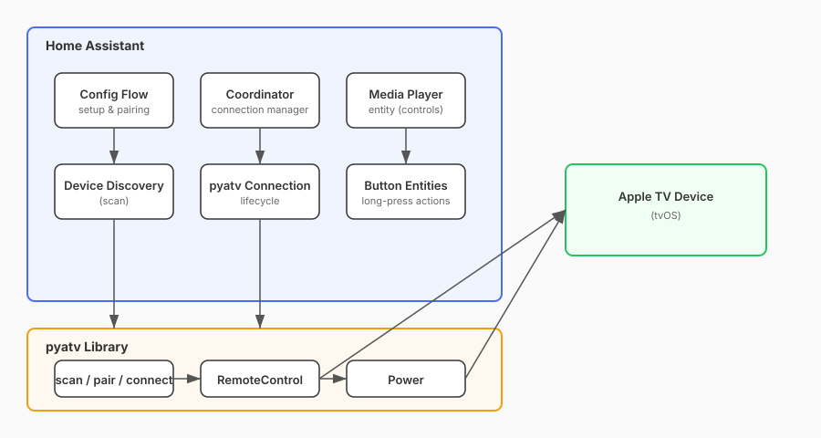
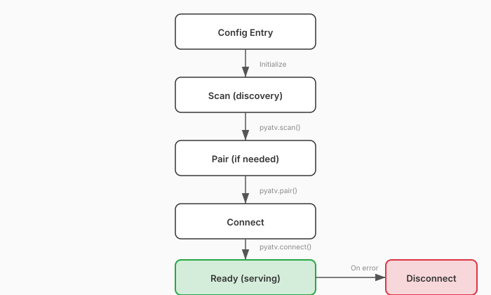
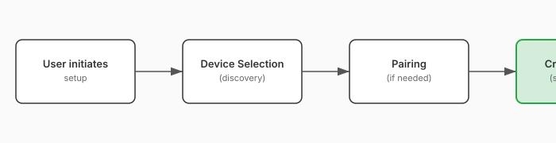
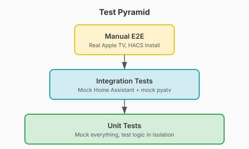

# Apple TV Control — Software Design & Implementation Plan

> **Status:** Draft  
> **Date:** 2026-11-16  
> **Target:** Home Assistant custom integration installed via HACS

---

## 1. Project Overview

### 1.1 Purpose

`apple-tv-control` is a Home Assistant custom integration that provides comprehensive remote-control functionality for Apple TV devices. Unlike the default Home Assistant Apple TV integration, which focuses on metadata and playback state, this integration prioritizes **device control** — navigation, media playback, power management, and advanced button actions (long press).

### 1.2 Goals

| Goal | Description |
|------|-------------|
| **Full remote control** | Expose all Apple TV remote buttons as Home Assistant services and UI controls |
| **Long-press support** | Support hold actions for Back (Menu) and TV (Home) buttons via pyatv `InputAction.Hold` |
| **Reliable connection** | Maintain stable connections with automatic reconnection on disconnect |
| **UI-based setup** | Config flow for device discovery, pairing, and credential management |
| **HACS compatibility** | Package and distribute via Home Assistant Community Store (HACS) |

### 1.3 Non-Goals

- Streaming media to Apple TV (AirPlay play URL)
- Advanced metadata browsing (album art, playlist management)
- Multi-room audio grouping
- RAOP/AirPlay speaker control

### 1.4 Dependencies

| Dependency | Version | Purpose |
|-----------|---------|---------|
| **Home Assistant** | ≥ 2024.1.0 | Host platform |
| **pyatv** | ≥ 0.18.0 | Apple TV communication library |
| **Python** | ≥ 3.13 | Runtime (matches Home Assistant core) |

---

## 2. Architecture

### 2.1 High-Level Component Diagram



### 2.2 Directory Structure

The integration follows the standard Home Assistant custom component layout:

```
apple-tv-control/
├── custom_components/
│   └── apple_tv_control/
│       ├── __init__.py              # Integration entry point
│       ├── manifest.json            # Integration metadata
│       ├── config_flow.py           # UI-based setup flow
│       ├── const.py                 # Constants and defaults
│       ├── coordinator.py           # DataUpdateCoordinator for connection
│       ├── media_player.py          # MediaPlayerEntity implementation
│       ├── button.py                # Button entities for long-press actions
│       ├── strings.json             # Localization strings
│       └── services.yaml            # Custom service definitions
├── hacs.json                        # HACS metadata
├── README.md                        # User documentation
├── docs/
│   └── dev/
│       └── DESIGN_AND_IMPLEMENTATION.md  # This document
├── tests/                           # Unit and integration tests
│   ├── conftest.py
│   ├── test_config_flow.py
│   ├── test_coordinator.py
│   ├── test_media_player.py
│   └── test_button.py
└── .github/
    └── workflows/
        └── validate.yml             # CI validation (hassfest)
```

### 2.3 Core File Responsibilities

| File | Responsibility |
|------|---------------|
| `__init__.py` | Integration setup/teardown, register platforms, store coordinator in `hass.data` |
| `manifest.json` | Domain, version, dependencies (`pyatv`), config flow flag, codeowners |
| `config_flow.py` | Device discovery via `pyatv.scan`, pairing via `pyatv.pair`, credential storage |
| `const.py` | Domain name, platform names, default values, feature flag mappings |
| `coordinator.py` | `DataUpdateCoordinator` subclass managing pyatv connection lifecycle, reconnection, and power state polling |
| `media_player.py` | `MediaPlayerEntity` with all standard remote controls (power, play/pause, volume, navigation) |
| `button.py` | `ButtonEntity` instances for specialized actions (Back long press, TV long press) |
| `strings.json` | English localization for config flow, entity names, and error messages |
| `services.yaml` | Custom services for actions not covered by media player entity (e.g., `apple_tv_control.navigate`) |

---

## 3. pyatv Integration Design

### 3.1 pyatv API Mapping

This section maps every feature in the README to the corresponding pyatv API call.

| Feature | pyatv API | Interface | Notes |
|---------|-----------|-----------|-------|
| Power on | `power.turn_on()` | `interface.Power` | Uses MRP or Companion protocol |
| Power off | `power.turn_off()` | `interface.Power` | May use `await_new_state=True` |
| Navigate Up | `remote_control.up()` | `interface.RemoteControl` | Single tap by default |
| Navigate Down | `remote_control.down()` | `interface.RemoteControl` | |
| Navigate Left | `remote_control.left()` | `interface.RemoteControl` | |
| Navigate Right | `remote_control.right()` | `interface.RemoteControl` | |
| Select | `remote_control.select()` | `interface.RemoteControl` | |
| Back | `remote_control.menu()` | `interface.RemoteControl` | Menu = Back on Apple TV |
| Back (long press) | `remote_control.menu(action=InputAction.Hold)` | `interface.RemoteControl` | Hold for 1 second |
| TV | `remote_control.home()` | `interface.RemoteControl` | Home/TV button |
| TV (long press) | `remote_control.home(action=InputAction.Hold)` | `interface.RemoteControl` | Hold for 1 second |
| Play | `remote_control.play()` | `interface.RemoteControl` | |
| Pause | `remote_control.pause()` | `interface.RemoteControl` | |
| Play/Pause toggle | `remote_control.play_pause()` | `interface.RemoteControl` | |
| Mute | `remote_control.mute()` | `interface.RemoteControl` | |
| Volume Up | `remote_control.volume_up()` | `interface.RemoteControl` | |
| Volume Down | `remote_control.volume_down()` | `interface.RemoteControl` | |

### 3.2 pyatv Protocols

The integration will use **MRP (Media Remote Protocol)** as the primary protocol, with **Companion** as a secondary protocol for enhanced power management.

| Protocol | Purpose | Pairing Required |
|----------|---------|-----------------|
| **MRP** | Remote control, metadata, power state | Yes |
| **Companion** | Enhanced power management, app launch | Yes |
| **AirPlay** | Metadata (read-only), artwork | No |

**Recommendation:** During config flow, attempt to pair both MRP and Companion protocols for the best experience. If Companion pairing fails, fall back to MRP-only.

### 3.3 Connection Lifecycle



### 3.4 Credential Storage

pyatv credentials are stored in Home Assistant's config entry data:

```python
# Config entry data structure
{
    "identifier": "AA:BB:CC:DD:EE:FF",   # Device MAC/UUID
    "name": "Living Room Apple TV",
    "host": "192.168.1.100",
    "mrp_credentials": "abc123...",       # MRP pairing credentials
    "companion_credentials": "def456...", # Companion pairing credentials (optional)
    "airplay_password": None,             # AirPlay password if applicable
}
```

---

## 4. Entity Design

### 4.1 Media Player Entity

The primary entity is a `MediaPlayerEntity` with `device_class=MediaPlayerDeviceClass.TV`.

#### 4.1.1 Supported Features

The entity will advertise these `MediaPlayerEntityFeature` flags:

```python
supported_features = (
    MediaPlayerEntityFeature.TURN_ON
    | MediaPlayerEntityFeature.TURN_OFF
    | MediaPlayerEntityFeature.PLAY
    | MediaPlayerEntityFeature.PAUSE
    | MediaPlayerEntityFeature.STOP
    | MediaPlayerEntityFeature.PLAY_PAUSE
    | MediaPlayerEntityFeature.VOLUME_UP
    | MediaPlayerEntityFeature.VOLUME_DOWN
    | MediaPlayerEntityFeature.VOLUME_MUTE
    | MediaPlayerEntityFeature.PREVIOUS_TRACK
    | MediaPlayerEntityFeature.NEXT_TRACK
    | MediaPlayerEntityFeature.SELECT_SOURCE
    | MediaPlayerEntityFeature.STOP
)
```

#### 4.1.2 State Mapping

Map pyatv power state and metadata to Home Assistant states:

| pyatv State | Home Assistant State |
|-------------|---------------------|
| `PowerState.On` + `State.Playing` | `MediaPlayerState.PLAYING` |
| `PowerState.On` + `State.Paused` | `MediaPlayerState.PAUSED` |
| `PowerState.On` + `State.Idle` | `MediaPlayerState.IDLE` |
| `PowerState.Off` | `MediaPlayerState.OFF` |
| Connection lost | `MediaPlayerState.UNAVAILABLE` |

#### 4.1.3 Method Implementations

| HA Method | pyatv Call | Notes |
|-----------|-----------|-------|
| `async_turn_on()` | `power.turn_on()` | |
| `async_turn_off()` | `power.turn_off()` | Use `await_new_state=True` |
| `async_media_play()` | `remote_control.play()` | |
| `async_media_pause()` | `remote_control.pause()` | |
| `async_media_play_pause()` | `remote_control.play_pause()` | |
| `async_media_stop()` | `remote_control.stop()` | |
| `async_volume_up()` | `remote_control.volume_up()` | |
| `async_volume_down()` | `remote_control.volume_down()` | |
| `async_mute_volume(mute)` | `remote_control.mute()` | Toggle mute |
| `async_media_next_track()` | `remote_control.next()` | |
| `async_media_previous_track()` | `remote_control.previous()` | |

#### 4.1.4 Navigation via Custom Services

Standard `MediaPlayerEntity` does not expose directional navigation (up/down/left/right/select). These will be exposed as **custom services** defined in `services.yaml`:

| Service | Action |
|---------|--------|
| `apple_tv_control.navigate` | Directional navigation with `direction` parameter |
| `apple_tv_control.select` | Press select button |
| `apple_tv_control.back` | Press back (menu) button |

**Navigate service data schema:**
```yaml
apple_tv_control.navigate:
  fields:
    direction:
      example: "up"
      selector:
        select:
          options:
            - "up"
            - "down"
            - "left"
            - "right"
```

### 4.2 Button Entities

Long-press actions are exposed as separate `ButtonEntity` instances, since `MediaPlayerEntity` has no standard action for hold gestures.

| Entity ID Pattern | Button Name | pyatv Call |
|-------------------|-------------|-----------|
| `button.{name}_back_long_press` | Back (Long Press) | `remote_control.menu(action=InputAction.Hold)` |
| `button.{name}_tv_long_press` | TV (Long Press) | `remote_control.home(action=InputAction.Hold)` |

Each button entity will:
- Inherit from `ButtonEntity`
- Reference the coordinator for the pyatv connection
- Execute the hold action on `async_press()`
- Report `UNAVAILABLE` when the device is disconnected

### 4.3 Device Registry Integration

All entities will be associated with a single device in Home Assistant's device registry:

```python
device_info = DeviceInfo(
    identifiers={(DOMAIN, config_entry.data["identifier"])},
    name=config_entry.data["name"],
    manufacturer="Apple Inc.",
    model=device_info.model,           # From pyatv DeviceInfo
    sw_version=str(device_info.version), # From pyatv DeviceInfo
)
```

---

## 5. Config Flow Design

### 5.1 Flow Steps

The config flow has three steps:



#### Step 1: User Initiation (`async_step_user`)

- Triggered from Settings → Devices & Services → Add Integration
- Presents a discovery step or manual entry form

#### Step 2: Device Selection (`async_step_discovery`)

- Calls `pyatv.scan()` to discover devices on the network
- Presents a dropdown of discovered devices (name + IP address)
- User selects the target Apple TV
- If no devices found, offer manual entry (IP address + identifier)

#### Step 3: Pairing (`async_step_pair`)

- Check if credentials already exist in storage
- If not paired:
  - Call `pyatv.pair(config, Protocol.MRP)` to initiate MRP pairing
  - Handle PIN code exchange (device-provided or user-provided)
  - Optionally attempt Companion pairing
  - Store credentials in the config entry
- If already paired, skip to entry creation

#### Entry Creation

- Store all connection data in `ConfigEntry.data`:
  ```python
  {
      "identifier": str,
      "name": str,
      "host": str,
      "mrp_credentials": str | None,
      "companion_credentials": str | None,
  }
  ```
- Set `unique_id` to the device identifier

### 5.2 Options Flow

An options flow will allow the user to:
- Re-pair the device (reset credentials)
- Enable/disable Companion protocol pairing
- Set a friendly name override

### 5.3 Reauth Flow

If connection fails due to expired/invalid credentials:
- Trigger `async_step_reauth`
- Guide the user through re-pairing
- Update the config entry with new credentials

---

## 6. Coordinator Design

### 6.1 AppleTvCoordinator Class

The coordinator extends `DataUpdateCoordinator` and manages the pyatv connection lifecycle:

```python
class AppleTvCoordinator(DataUpdateCoordinator[AppleTvData]):
    """Manages Apple TV connection and state updates."""

    def __init__(self, hass: HomeAssistant, config_entry: ConfigEntry):
        super().__init__(
            hass,
            _LOGGER,
            name=DOMAIN,
            update_interval=timedelta(seconds=30),  # Polling fallback
        )
        self.config_entry = config_entry
        self.atv: AppleTV | None = None
        self._connected = False

    async def _async_update_data(self) -> AppleTvData:
        """Poll power state and metadata from the device."""
        ...

    async def connect(self) -> None:
        """Establish connection to the Apple TV."""
        ...

    async def disconnect(self) -> None:
        """Gracefully close the connection."""
        ...

    @property
    def remote_control(self) -> RemoteControl:
        """Return the remote control interface."""
        ...

    @property
    def power(self) -> Power:
        """Return the power management interface."""
        ...
```

### 6.2 Data Model

```python
@dataclass
class AppleTvData:
    """Data held by the coordinator."""
    power_state: PowerState
    playing: Playing | None       # Current metadata
    connected: bool
    app_name: str | None          # Currently active app
```

### 6.3 Reconnection Strategy

| Scenario | Behavior |
|----------|----------|
| Normal disconnect (HA shutdown) | `atv.close()` in `async_unload_entry` |
| Connection error during command | Log warning, attempt single reconnect, retry command |
| Repeated failures (≥ 3) | Mark entity as `UNAVAILABLE`, backoff with exponential delay |
| Deep sleep detection | pyatv `scan()` returns `deep_sleep=True` — mark unavailable, do not reconnect until next scan |
| Push update disconnect | Auto-reconnect on `connection_lost` callback |

### 6.4 Push Updates vs. Polling

pyatv supports **push updates** via `PushUpdater`, which is preferred over polling:

1. **Primary:** Register a `PushUpdater` listener for real-time state changes
2. **Fallback:** Coordinator polling interval (30 seconds) as a safety net
3. **On push update:** Call `self.async_set_updated_data(...)` to refresh entities

---

## 7. Implementation Phases

### Phase 1: Project Scaffolding

**Goal:** Establish the integration skeleton with proper metadata.

| Task | Deliverable |
|------|-------------|
| Create `custom_components/apple_tv_control/` directory | Directory structure |
| Write `manifest.json` | Domain, version, pyatv dependency, config_flow flag |
| Write `const.py` | Domain name, platform list, default values |
| Write `__init__.py` (stub) | Empty `async_setup_entry` / `async_unload_entry` |
| Write `hacs.json` | HACS metadata |
| Write `strings.json` | Config flow strings |
| Verify with `hassfest` | CI validation passes |

**Definition of Done:** `hassfest` validation passes, integration appears in Home Assistant integrations list.

---

### Phase 2: Config Flow

**Goal:** UI-based device discovery and pairing.

| Task | Deliverable |
|------|-------------|
| Implement `AppleTvConfigFlow` | Config flow class |
| Implement `async_step_user` | Entry point |
| Implement `async_step_discovery` | Device scan and selection |
| Implement `async_step_pair` | MRP pairing with PIN handling |
| Implement credential storage | Store in `ConfigEntry.data` |
| Implement `async_step_reauth` | Re-pairing flow |
| Write unit tests | Mock pyatv scan/pair, verify flow steps |

**Definition of Done:** User can add the integration via UI, select a device, complete pairing, and see a config entry.

---

### Phase 3: Connection Coordinator

**Goal:** Reliable connection management with reconnection logic.

| Task | Deliverable |
|------|-------------|
| Implement `AppleTvCoordinator` | DataUpdateCoordinator subclass |
| Implement `connect()` | pyatv connect with credentials |
| Implement `disconnect()` | Graceful close |
| Implement `_async_update_data()` | Power state and metadata polling |
| Implement push update listener | Real-time state changes |
| Implement reconnection logic | Exponential backoff, deep sleep handling |
| Register coordinator in `__init__.py` | Store in `hass.data[DOMAIN]` |
| Write unit tests | Mock pyatv connect/disconnect, verify reconnection |

**Definition of Done:** Coordinator connects to a real or mocked Apple TV, reports power state, and reconnects on disconnect.

---

### Phase 4: Media Player Entity — Core Controls

**Goal:** Power, play/pause, and volume controls via the media player entity.

| Task | Deliverable |
|------|-------------|
| Implement `AppleTvMediaPlayer` | MediaPlayerEntity subclass |
| Implement `async_turn_on()` / `async_turn_off()` | Power control |
| Implement `async_media_play()` / `async_media_pause()` | Playback control |
| Implement `async_volume_up()` / `async_volume_down()` / `async_mute_volume()` | Volume control |
| Implement `@property state` | State mapping from pyatv |
| Implement `@property supported_features` | Feature flag bitmask |
| Register platform in `__init__.py` | `async_forward_entry_setups` |
| Write unit tests | Verify each method calls the correct pyatv API |

**Definition of Done:** Media player entity appears in Home Assistant with power, play/pause, and volume controls working.

---

### Phase 5: Navigation Controls

**Goal:** Directional navigation and select via custom services.

| Task | Deliverable |
|------|-------------|
| Define `services.yaml` | Navigate, select, back services |
| Implement `apple_tv_control.navigate` service | Directional navigation |
| Implement `apple_tv_control.select` service | Select button |
| Implement `apple_tv_control.back` service | Back/menu button |
| Register services in `__init__.py` | `async_register_services` |
| Write unit tests | Verify service calls map to pyatv RemoteControl methods |

**Definition of Done:** User can call navigate, select, and back services from automations or the developer console.

---

### Phase 6: Advanced Controls — Long Press

**Goal:** Long-press actions for Back and TV buttons via button entities.

| Task | Deliverable |
|------|-------------|
| Implement `AppleTvButtonEntity` base class | ButtonEntity subclass with coordinator access |
| Implement Back long press button | `menu(action=InputAction.Hold)` |
| Implement TV long press button | `home(action=InputAction.Hold)` |
| Register button platform in `__init__.py` | `async_forward_entry_setups` |
| Write `strings.json` entries | Entity names and descriptions |
| Write unit tests | Verify button press triggers hold action |

**Definition of Done:** Two button entities appear in Home Assistant for long-press actions, callable from automations.

---

### Phase 7: HACS Packaging and Documentation

**Goal:** Package the integration for distribution via HACS.

| Task | Deliverable |
|------|-------------|
| Write `hacs.json` | Name, version, HACS category |
| Write `README.md` | Installation instructions, feature list, usage examples |
| Write `.github/workflows/validate.yml` | CI with hassfest and ruff/flake8 |
| Add `.gitignore` | Exclude `.venv`, `__pycache__`, etc. |
| Add `LICENSE` | MIT or Apache 2.0 |
| Create initial release tag | `v0.1.0` |
| Manual HACS testing | Install from local repository, verify all features |

**Definition of Done:** Integration is installable via HACS from a public GitHub repository, all features work end-to-end.

---

## 8. Risks and Mitigations

### 8.1 Connection Stability

**Risk:** pyatv connections to Apple TV can drop unexpectedly, especially during deep sleep transitions.

**Mitigation:**
- Implement exponential backoff reconnection in the coordinator
- Use push updates to detect disconnection early
- Mark entities as `UNAVAILABLE` rather than throwing errors on stale connections
- Handle deep sleep detection from `pyatv.scan()` results

### 8.2 pyatv Version Compatibility

**Risk:** pyatv API may change between versions, breaking the integration.

**Mitigation:**
- Pin pyatv to a specific major version in `manifest.json` requirements
- Monitor pyatv release notes for breaking changes
- Write integration tests that mock pyatv interfaces, not implementations

### 8.3 Deep Sleep Handling

**Risk:** Apple TV enters deep sleep (low-power mode) where it is unreachable via MRP.

**Mitigation:**
- Detect deep sleep via `pyatv.scan()` `deep_sleep` flag
- Use Companion protocol if available for more reliable power state
- Document the limitation in the README
- Consider Wake-on-LAN (WoL) as a future enhancement for power-on from deep sleep

### 8.4 Pairing Reliability

**Risk:** MRP pairing can fail if the user doesn't respond to the PIN prompt in time.

**Mitigation:**
- Implement a timeout with clear error messages in the config flow
- Allow retry of the pairing step
- Store pairing state so the user can resume if interrupted

### 8.5 Home Assistant API Changes

**Risk:** Home Assistant core API changes between versions may break the integration.

**Mitigation:**
- Specify minimum Home Assistant version in `hacs.json`
- Run `hassfest` in CI to validate against the latest Home Assistant version
- Follow Home Assistant contributor guidelines for forward compatibility

---

## 9. Testing Strategy

### 9.1 Test Pyramid



### 9.2 Unit Tests

| Component | Test Focus | Mock Strategy |
|-----------|-----------|---------------|
| Config Flow | Step transitions, validation, abort conditions | Mock `pyatv.scan()` and `pyatv.pair()` |
| Coordinator | Connect/disconnect lifecycle, reconnection logic | Mock `pyatv.connect()`, simulate errors |
| Media Player | State mapping, feature flags, method delegation | Mock coordinator and pyatv interfaces |
| Button Entities | Press action triggers correct pyatv call | Mock coordinator |

**Framework:** `pytest-asyncio` for async test support, `pytest-homeassistant-custom-component` for Home Assistant fixtures.

### 9.3 Integration Tests

- Test full config flow with a mocked Home Assistant instance
- Test entity registration and state updates
- Test service call handling end-to-end

### 9.4 Manual Testing Checklist

| Scenario | Expected Outcome |
|----------|-----------------|
| Add integration via UI | Device discovered, pairing completes, entities appear |
| Power on/off | Apple TV turns on/off, state updates in HA |
| Play/pause | Media playback toggles correctly |
| Volume up/down | Volume changes on the device |
| Navigate up/down/left/right | Menu cursor moves in the expected direction |
| Select | Selected item is activated |
| Back | Returns to previous menu |
| Back long press | Triggers long-press behavior (quick menu) |
| TV | Returns to TV home screen |
| TV long press | Triggers long-press behavior (Siri/quick menu) |
| Device disconnects | Entities show UNAVAILABLE, reconnect on recovery |
| Deep sleep | Entities show UNAVAILABLE, no spurious reconnection attempts |

---

## 10. Custom Services Reference

### 10.1 `apple_tv_control.navigate`

Send a directional navigation command to the Apple TV.

```yaml
service: apple_tv_control.navigate
target:
  entity_id: media_player.living_room_apple_tv
data:
  direction: "up"  # up, down, left, right
```

### 10.2 `apple_tv_control.select`

Press the select (center) button.

```yaml
service: apple_tv_control.select
target:
  entity_id: media_player.living_room_apple_tv
```

### 10.3 `apple_tv_control.back`

Press the back (menu) button.

```yaml
service: apple_tv_control.back
target:
  entity_id: media_player.living_room_apple_tv
```

---

## 11. Appendix

### 11.1 pyatv FeatureName Enum Reference

Key `FeatureName` values used by this integration:

| FeatureName | Description | Used By |
|-------------|-------------|---------|
| `TurnOn` | Turn device on | Power.turn_on |
| `TurnOff` | Turn device off | Power.turn_off |
| `PowerState` | Current power state | Coordinator polling |
| `Play` | Start playback | RemoteControl.play |
| `Pause` | Pause playback | RemoteControl.pause |
| `PlayPause` | Toggle play/pause | RemoteControl.play_pause |
| `Up` / `Down` / `Left` / `Right` | Arrow keys | RemoteControl |
| `Select` | Select button | RemoteControl.select |
| `Menu` | Back/menu button | RemoteControl.menu |
| `Home` | Home/TV button | RemoteControl.home |
| `VolumeUp` / `VolumeDown` | Volume controls | RemoteControl |
| `Mute` | Mute toggle | RemoteControl.mute |

### 11.2 Home Assistant MediaPlayerEntityFeature Reference

| Flag | Value | Description |
|------|-------|-------------|
| `TURN_ON` | 128 | Turn the player on |
| `TURN_OFF` | 256 | Turn the player off |
| `PLAY` | 16384 | Start or resume playback |
| `PAUSE` | 2 | Pause playback |
| `STOP` | 64 | Stop playback |
| `VOLUME_UP` | 512 | Increase volume |
| `VOLUME_DOWN` | 256 | Decrease volume |
| `VOLUME_MUTE` | 8 | Mute/unmute |
| `PREVIOUS_TRACK` | 16 | Previous track |
| `NEXT_TRACK` | 32 | Next track |
| `SELECT_SOURCE` | 2048 | Select input source |

### 11.3 InputAction Enum Reference

| Action | Description | pyatv Usage |
|--------|-------------|-------------|
| `SingleTap` | Press and release quickly | Default for all buttons |
| `DoubleTap` | Press and release twice quickly | Not used in this integration |
| `Hold` | Press and hold for 1 second | Back long press, TV long press |

---

## 12. Changelog

| Date | Version | Changes |
|------|---------|---------|
| 2026-11-16 | 0.1.0-draft | Initial design document |
